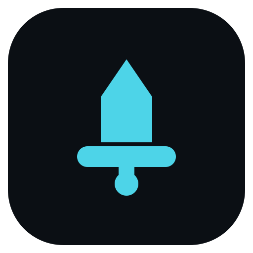

<p align="center">
  
</p>
<h1 align="center">gladius</h1>
<p align="center"><strong>Stop walking pages by hand. Give your agent a browser it can drive.</strong></p>

## Install

```powershell
npx gladius-mcp --doctor
```
You need Node 22.14 or newer on Windows x64 first. Your first real serve run provisions the pinned server runtime (0.4.2) plus the pinned chrome-headless-shell browser (155.0.8059.84), both hash-verified, while `--doctor` only prints the manifest with the resolved cache paths and exits 0 without downloading anything.
Global installs are refused by design — use `npx`, never `npm i -g`.

### Or let your AI install it

```text
Install the npm package gladius-mcp from nathwn12/gladius into my MCP client config, served with npx gladius-mcp@latest over stdio.
Then verify with npx gladius-mcp@latest --doctor and npm view gladius-mcp version and show me both outputs.
```

### Wire it yourself

Wire the server into your MCP client config:

```json
{
  "mcpServers": {
    "gladius": {
      "command": "npx",
      "args": [
        "gladius-mcp@latest"
      ]
    }
  }
}
```

### Overrides

Use `npx gladius-mcp@latest` for installs. A pinned version is only installable while its GitHub release still exists; the one-release policy deletes older releases, so pinned versions are not a supported long-term install.
Point the launcher at a browser you already hold to skip the browser download. Set `GLADIUS_CHROMIUM` to your chrome-headless-shell binary before you start the server:
```powershell
$env:GLADIUS_CHROMIUM = "<path-to-your-chrome-headless-shell-binary>"
```
Redirect the caches with `GLADIUS_ENGINE_CACHE` and `GLADIUS_CHROMIUM_CACHE`, or inspect the pin with no network access:
```powershell
npx -y gladius-mcp@latest --print-manifest
```
The names above come from `gladius-mcp --help`. There is no fully offline fresh install: the first run still downloads the pinned runtime, so treat these as pins and overrides, not as a no-network setup.

## Use it

Open a page with the `navigate` tool:
```json
{
  "url": "https://example.com"
}
```
You get back JSON carrying the page `url` and `title` once the load event fires. Read a value with the `evaluate` tool:
```json
{
  "expression": "window.__gladiusValue"
}
```
Against the repo test page you get back:
```json
{
  "value": 42
}
```
Grab text without driving the browser with the `fetch_text` tool:
```json
{
  "url": "https://example.com"
}
```
You get back the page text with tags stripped and scripts dropped.

## What you get

- An agent that works the page for you: 22 tools to open pages, snapshot the real Accessibility tree (default; `mode:"legacy"` keeps the old DOM heuristic), click, type, screenshot, read the console, target frames and workers, wait on JS predicates, handle dialogs, walk history, read the network, manage cookies and web storage (save/load), and drive raw CDP (docs/ARCHITECTURE.md). The `storage` tool reports exactly these reply keys (required: `ok`, `action`): `ok`, `action`, `scope`, `url`, `origin`, `cookies`, `localStorage`, `sessionStorage`, `counts`, `set`, `cleared`, `failed`, `applied`, `path`, `bytes`, `fileOrigin`, `redacted`, `note`; it sits immediately after `tabs` in `tools/list`. Hidden/ignored subtrees stay out of the snapshot (an old ref to one is a typed `stale_ref`); acting on a shadow-DOM ref is not yet supported.
- The same browser every run: pinned chrome-headless-shell, hash-verified and provisioned on first run, shown by --doctor (docs/CHROMIUM.md).
- A small local footprint: one native binary over stdio that starts the browser only when the first tool call needs it (docs/ARCHITECTURE.md).
- Errors you can act on: typed tool errors, buffered console messages plus uncaught exceptions, and a headless-only engine with no silent fallback (docs/ENGINE.md).
- Trusted, frame-aware input: `click`/`type` drive real CDP pointer and `insertText` events (`isTrusted:true`) after scroll, hit-test, and settle - occluded or non-editable targets are typed errors, never silent clicks. `click`/`type`/`hover`/`select`/`upload` take `frame=` to act inside an iframe (per-level owner hit-test; `@eN` refs stay main-frame); `key` handles `Ctrl+A`-style combos with a modifier mask.
- Machine-readable contract: every tool has a versioned `outputSchema` plus `readOnly`/`destructive`/`idempotent`/`openWorld` annotations, and every failure carries a typed `structuredContent` code/reason beside the prose.
- Headless-only by owner decision: no headed code path exists and none is planned (docs/HEADED-MODE.md); the visible path is an explicit external attach that gladius never owns.

## Configure it

Run with no flags to provision the pinned runtime plus browser on first run, then serve MCP over stdio. The flags, from `gladius-mcp --help`, are:

- `--doctor`, `--print-manifest`: print the pinned manifest with the resolved cache paths and exit 0. Default: neither set. Both perform no network access.
- `--help`, `-h`: print usage. Any other flag prints usage and exits 2.

You override paths and platform handling with four env vars:

- `GLADIUS_CHROMIUM`: your explicit chrome-headless-shell binary. Default unset, so the launcher provisions the pinned browser. When you set it to a non-empty path, browser provisioning is skipped.
- `GLADIUS_ENGINE_CACHE`: runtime cache root. Default the OS local-app-data directory, giving a `gladius\engine\<serverVersion>-<bundleSha8>` folder under it.
- `GLADIUS_CHROMIUM_CACHE`: browser cache root. Default the OS local-app-data directory, giving a `gladius\chromium\<version>-<zipSha8>` folder under it.
- `GLADIUS_MCP_ALLOW_NON_WINDOWS`: set it to `1` to bypass the Windows-only gate for diagnostics. Default unset, so other platforms are refused. The server runtime still runs on Windows x64 only.

Use `npx gladius-mcp@latest` for installs. A pinned version is only installable while its GitHub release still exists; the one-release policy deletes older releases, so pinned versions are not a supported long-term install.

## Requirements

- Node 22.14 or newer (package engines, checked with `node --version`).
- Windows x64. Other platforms are refused unless you set the diagnostics override named in `--help`.
- The first run downloads two pinned artifacts, both hash-verified: the server runtime from the tagged GitHub Release and the browser from the Chrome for Testing endpoint (docs/PUBLISHING.md).

## Links

- Repo: https://github.com/nathwn12/gladius
- Package: https://www.npmjs.com/package/gladius-mcp
- Releases: https://github.com/nathwn12/gladius/releases
- Issues: https://github.com/nathwn12/gladius/issues
- Docs: [browser pin](docs/CHROMIUM.md), [engine notes](docs/ENGINE.md), [headless-only decision](docs/HEADED-MODE.md), [changelog](CHANGELOG.md)
- License: MIT, see [LICENSE](LICENSE)

<!-- nathwn12 house footer: identical in every repo. Do not edit. -->
<p align="center">
  <a href="https://github.com/nathwn12"></a>
</p>
<p align="center">
  <sub>Built by <a href="https://github.com/nathwn12">nathwn12</a> · <a href="https://github.com/nathwn12?tab=repositories">All projects</a></sub>
</p>
