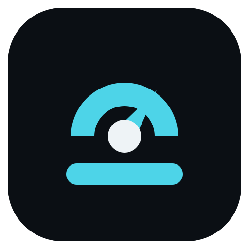

<p align="center">
  
</p>

<h1 align="center">oc-flight-deck</h1>

<p align="center"><strong>Live cost, token, cache and context telemetry for every OpenCode session, drawn in your sidebar.</strong></p>

<p align="center">
  <a href="https://www.npmjs.com/package/oc-flight-deck"></a>
  
  <a href="https://github.com/nathwn12/oc-collections/blob/main/LICENSE"></a>
</p>

## Why

Cost and context are easy to lose sight of during a long session. `oc-flight-deck` draws them beside the session, live, so you see the roll-up without leaving the run. A cache hit rate excludes writes from its denominator, because a write is not a lookup. Elapsed time is recomputed from the turn spans the host recorded, so it survives a restart and never steps backwards. Estimates carry a `~` and say so out loud.

Every setting lives in one global file, not per project.

## Install

Add the entry to the `plugins` array in your `opencode.jsonc`, then restart OpenCode:

```json
{ "plugins": ["oc-flight-deck"] }
```

## Use

The rail draws up to 18 named rows in the order you choose. Among them are:

- **Honest zeros** — every numeric row draws a real zero when there is no data, never a dash or a blank.
- **Money** — the current model's spend for this session, and a durable lifetime total for the subagent tree. The old `cost` and `total` row names still work as aliases.
- **Tokens and cache** — input and output tokens, and a cache hit rate with writes excluded.
- **Context gauge** — occupancy as a bar plus a percentage, marked `~` when estimated.
- **Speed** — a settled-turn average, a realtime estimate, or both plus time to first token.
- **Caution annunciator** — an opt-in watchdog that stays silent until a tool or a turn stops moving, and reports what it saw without killing anything.
- **Quota and session rows** — the Go usage dials, and a session id row that copies the full id on click.

## Configure

All settings live in one global file; there are no per-project files. Start from the [example config](https://github.com/nathwn12/oc-collections/blob/main/packages/oc-flight-deck/flight-deck.example.jsonc) and check the [schema](https://github.com/nathwn12/oc-collections/blob/main/packages/oc-flight-deck/flight-deck.schema.json) for each key and its default.


## Requirements

- OpenCode 2.1.1 or newer.
- Node 22 or newer, or Bun 1.4 or newer.
- Any platform the host runs on.

## Links

- [Issues](https://github.com/nathwn12/oc-collections/issues)
- [Releases](https://github.com/nathwn12/oc-collections/releases)
- [Guide](https://github.com/nathwn12/oc-collections/blob/main/packages/oc-flight-deck/docs/GUIDE.md)
- [MIT licence](https://github.com/nathwn12/oc-collections/blob/main/LICENSE)

<p align="center"><sub>Built by nathwn12</sub></p>
