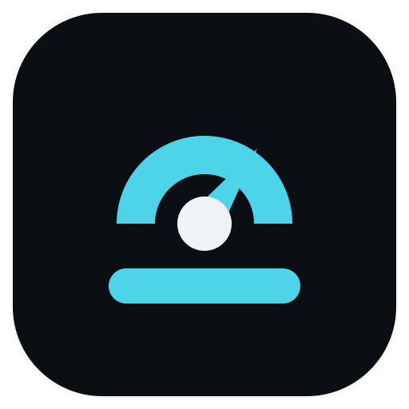

<p align="center">
  
</p>
<h1 align="center">oc-flight-deck guide</h1>

## How it works

The plugin registers one sidebar rail and one ticker. On every tick it reads what the host already recorded and redraws the rows that changed; it never writes to the session and never blocks a turn.

**Three scopes decide which numbers you see.** `cost`, `tokens`, `cache`, `reasoning` and `tps` roll up the open conversation plus the subagent sessions the host links to it by `parentID`. `project` covers every session in the project. `elapsed` counts active turn time, not wall clock. The link is the host's own: an independently spawned top-level session is not counted as a child, and `project` is the surface for that.

**Refresh behaviour.** The rail ticks every `refresh` milliseconds (default `100`, allowed range 0–60000; values 1–15 clamp up to 16). While nothing is happening the tick backs off to about one second, so an idle session costs almost nothing. `refresh: 0` turns the ticker off entirely: clock-derived rows then move only when the host fires an event, and a row that needs a tick to change its number simply stops moving. Host events always redraw immediately, whatever the interval.

**Restart safety.** Elapsed time and speed are recomputed from the assistant-turn spans the host recorded, not accumulated in memory, so a restart does not reset the clock and elapsed time never steps backwards while the host still reports those turns.

**Config precedence.** Host plugin options beat `flight-deck.jsonc`, which beats the defaults, merged key by key. A bad value restores its default and raises a one-time toast naming the key.

## Panels

One rail, in the order you list the rows, dimmed under any fixed lines. A session with subagents, defaults, a 200k window:

```text
status    ⠙ running
agent     build
model     claude-sonnet-4-5 · high
cost      $1.84 · 3 subagents
project   $12.40 · 21 sessions
tokens    1.2M in · 84k out
cache     92% hit · 1.1M read
context   ████████░░ ~78%
perms     1 waiting · bash
elapsed   2h 14m 07s
tps       41 tok/s
```

Which rows draw is `sidebar.rows`; what each row's number means is the Rows table under Configure it.

**The footer.** `sidebar.footer.lines` puts fixed text in the host footer slot, outside the rail cap; the documented branding pair is `["▸ FLIGHT DECK","─────────────────"]`.

**The Go panel.** `sidebar.footer.go` adds the live Go usage panel: three fixed-width lines above the host location row, sharing one account-wide poll with the `go` row.

## Configure it

One global file: `~/.config/opencode/flight-deck.jsonc`. The `.json` name is also read, and `.jsonc` is tried first. When `$XDG_CONFIG_HOME` holds an absolute path, the file lives at `$XDG_CONFIG_HOME/opencode/flight-deck.jsonc` instead. There is no per-project lookup, so a copy left in a project root configures nothing. A missing file is normal and silent: you get the defaults. Comments and trailing commas are accepted by the Bun-hosted TUI.

```jsonc
{
  "sidebar": { "rows": ["status", "cost", "context", "elapsed"] }
}
```

### Settings

**Refresh**

| Key | Default | Effect |
| --- | --- | --- |
| **`refresh`** | `100` | Milliseconds between ticks, 0–60000. Values 1–15 clamp to 16; `0` turns the ticker off, so clock-derived rows move only on host events. While idle the tick backs off to about 1s. |

**Sidebar**

| Key | Default | Effect |
| --- | --- | --- |
| **`sidebar.enabled`** | `true` | `false` leaves the plugin loaded but invisible. |
| **`sidebar.rows`** | `["status","agent","model","cost","project","tokens","cache","context","perms","elapsed","tps"]` | Live rows, top to bottom, any subset in any order. Max 24 names; unknown names are ignored with a one-time warning. |
| **`sidebar.lines`** | `[]` | Fixed lines above the rows. Max 24. These plus rows share the rail cap (`maxLines`); fixed lines render at full brightness while live rows are dimmed. |
| **`sidebar.footer.lines`** | `[]` | Fixed lines in the host footer slot, outside the rail cap; max 24. |
| **`sidebar.footer.go`** | `false` | `true` or an object draws the live Go usage panel. Object keys: `header` (`false`), `barWidth` (`10`, 1–40), `labelWidth` (`6`, 5–24, auto-widens), `percent` (`true`), `reset` (`true`), `align` (`"right"`, left, right, or center), `sweep` (`false`), `labels` (`{rolling,weekly,monthly}`, each 1–24 chars), `blink` (`true`), `blinkMs` (`700`, 200–5000). |
| **`sidebar.persist`** | `true` | Every named row renders, drawing its zero skeleton until data arrives; `false` omits rows with no data. |
| **`sidebar.placeholder`** | `"—"` | Non-empty string; only for a data-less row with no skeleton. `caution` never draws it, and `updated` draws it until the host records an action. |
| **`sidebar.maxLines`** | `24` | Whole rail, fixed lines plus rows, 1–24. |
| **`sidebar.tps.scope`** | `"family"` | `"family"` paces the open session plus subagents; `"session"` paces the open session alone. |
| **`sidebar.tps.display`** | `"avg"` | `"avg"` settled-turn average, `"rt"` realtime estimate, `"both"` both figures plus ttft. |

**Footer**

| Key | Default | Effect |
| --- | --- | --- |
| **`footer.enabled`** | `true` when any other footer key is present, `false` when the section is absent | Writing any footer key turns it on. |
| **`footer.text`** | `"Flight Deck"` | Max 120 chars; control chars become spaces. |

**Caution**

| Key | Default | Effect |
| --- | --- | --- |
| **`caution.enabled`** | `false` | Run the annunciator; off means no row and no timer. |
| **`caution.toolWatchSeconds`** | `180` | A tool running longer draws `▲`. |
| **`caution.toolCautionSeconds`** | `420` | A tool running longer becomes `●`; raised to the watch value if lower. |
| **`caution.turnWatchSeconds`** | `600` | A running session producing nothing draws `▲`; suppressed while a tool or shell runs. |
| **`caution.turnCautionSeconds`** | `1200` | Quiet session becomes `●`; same raise rule. All four thresholds take 0 or more. |
| **`caution.repeatThreshold`** | `3` (min 2) | Identical consecutive calls before a loop is reported; applies to successes and failures. |
| **`caution.exemptTools`** | `["question","task","subagent","agent","delegate","delegate_many","delegate_task","tools.delegate","tools.delegate_many","tools.subagent","tools.task"]` | Matched by exact name. Calibrated against 54,218 settled calls: 307 exceed 180s and 200 of those are these tools; `subagent` alone crossed 152 times, p99 14.7 min. |
| **`caution.toast`** | `false` | Toast once per distinct problem, re-arming when the session goes quiet. |

**Notifications**

| Key | Default | Effect |
| --- | --- | --- |
| **`notifications.enabled`** | `true` | The one-key off switch; `false` silences every toast. |
| **`notifications.config`** | `true` | The one-time toast naming a bad config key. |
| **`notifications.copy`** | `true` | The toast for an unverified copy. |
| **`notifications.caution`** | `true` | The opt-in caution toast. Every flag only silences. |

**Layout**

| Key | Default | Effect |
| --- | --- | --- |
| **`layout.labelWidth`** | `10` (6–24) | Label column width. |
| **`layout.barWidth`** | `10` (1–40) | Context gauge cells. |
| **`layout.sparkWidth`** | `12` (2–64) | Sparkline samples. |
| **`layout.labels`** | `{}` | Rename any row by its canonical key, for example `{ "cost": "session", "total": "lifetime" }`. A label wider than the column still gets a space before its value. |

**Format**

| Key | Default | Effect |
| --- | --- | --- |
| **`format.duration`** | `"spaced"` (`2h 14m 37s`) | Or `"compact"` (`2h14m37s`). Zero-padding is the same either way (`14m 07s`, never `14m 7s`). |
| **`format.timestamp.locale`** | the host locale | BCP-47 locale for the `updated` row, for example `"en-GB"`. A malformed locale is reported and the host locale is used. |
| **`format.timestamp.dateStyle`** | `"short"` | `"short"` (locale numeric date), `"medium"` (spelled month, wider), or `"none"` (time only). |
| **`format.timestamp.timeStyle`** | `"medium"` | `"medium"` keeps seconds, `"short"` drops them, `"none"` leaves a date-only row. Both halves cannot be `"none"`: the pair falls back to the defaults with a warning. |
| **`format.timestamp.hour12`** | the locale's own clock | `true` forces `2:32:07 PM`, `false` forces `14:32:07`. |
| **`format.timestamp.timeZone`** | the host zone | An IANA name (`"Asia/Tokyo"`) or UTC offset (`"+05:30"`). Omit it to follow the host through daylight-saving changes; a Windows zone id is not valid and is reported, with the host zone used. |

**Glyphs**

| Key | Default | Effect |
| --- | --- | --- |
| **`glyphs.watch`** | `"▲"` | The watch glyph, 1–2 chars. |
| **`glyphs.caution`** | `"●"` | The caution glyph, 1–2 chars. |
| **`glyphs.clear`** | `"○"` | Reserved, not drawn today. |

**Style**

| Key | Default | Effect |
| --- | --- | --- |
| **`style.lines`** | `{color:"default", attributes:[]}` | Fixed-line look. |
| **`style.rows`** | wildcard `"*": {color:"subdued", attributes:[]}` plus per-row overrides | Colors are theme roles: default, subdued, warning, error, success, info. Attributes: bold, dim, italic, underline, blink, inverse, hidden, strikethrough. |

### Rows

Every name `sidebar.rows` accepts, what its number means, and whether it draws by default.

| Row | What it shows | Default |
| --- | --- | --- |
| `caution` | Annunciator, opt-in with `caution.enabled`. Silent unless a tool or turn stops moving. Reports observations, never verdicts (`shell running 8m41s`). Never aborts, kills, retries, or blocks. `▲` watch, `●` caution, `○` reserved and not drawn. | opt-in |
| `status` | `⠙ running` while anything works (this session, a subagent, or a shell); `○ idle` otherwise. | yes |
| `agent` | Active agent name. | yes |
| `model` | Model id, plus ` · variant` when one is present. | yes |
| `branch` | Current git branch. Costs a VCS call. | opt-in |
| `cost` | Money for this conversation plus its subagent tree. With `total` on the rail, this row shows the session's own figure. Merged shape `$1.84 · 3 subagents`; childless shows `$1.84`. | yes |
| `total` | Family total plus subagent count, `$1.84 · 0 subagents` when childless. | opt-in |
| `project` | Every session in the project: `$12.40 · 21 sessions` when more than one, else just the figure. | yes |
| `tokens` | `1.2M in · 84k out`, same family scope as `cost`. | yes |
| `cache` | `92% hit · 1.1M read`, family scope. The hit-rate denominator is cache read plus input; cache write is excluded because a write is not a lookup. A zero read is drawn (`0 read`, or `0% hit · 0 read` when input exists), never hidden. | yes |
| `context` | Occupancy proxy (last request input plus cache read plus cache write), drawn as a `layout.barWidth`-cell gauge (10 by default) plus `~78%`, or `~N used` when no limit is known. The `~` is deliberate: this is an estimate. | yes |
| `perms` | Pending approvals. One names the action plus an 18-cell clipped resource (`bash · src/tui…`); several lead with the count (`3 waiting · bash`). | yes |
| `elapsed` | Active generation time, recomputed from the assistant-turn spans the host recorded for this session and its subagents. Survives a restart, never steps backwards while the host reports those turns, and is not wall-clock since the session began. | yes |
| `updated` | Absolute timestamp of the newest action the host recorded: the latest message's `completed`, else `streamed`, else `created` stamp. The host locale and time zone apply by default; `format.timestamp` sets the locale, date and time styles, the 12/24-hour clock, and an IANA zone or UTC offset. A Windows zone id is rejected and the host zone is used. | opt-in |
| `tps` | Session speed. Default `avg`: generation tokens (output plus reasoning) over the union of settled turns' `streamed − created` spans; idle gaps never billed. `rt`: realtime estimate from streaming deltas, zero while nothing generates. `both`: `106 rt · 41 avg`, plus `1.2s ttft` once a step settles. Scope `family` (default; open session plus subagents, overlapping spans merged) or `session`. Below half a token per second no figure is drawn; with `persist: true` the row falls back to its `0 tok/s` skeleton, and `persist: false` omits it. | yes |
| `spark` | Recent turn sizes as a sparkline; the newest samples are kept. | opt-in |
| `reasoning` | Reasoning tokens, family scope. | opt-in |
| `turns` | Prompts sent this session. | opt-in |
| `guard` | Harness status when a guard bridge supplies it (breaches, orphans, findings, or ok). Without the bridge the row has no data. | opt-in |
| `go` | Zen Go usage: three dials (`○ ◔ ◑ ◕ ●`) plus percent for 5h, 1w, 1m, read from OpenCode's own active opencode-go credential store; no env var. A window at 90% or more, or non-ok, turns red; only the worst flagged window carries a reset countdown. | opt-in |
| `ses` | Clipped 18-cell preview of the session id (less when the label column is narrow, floored at 8), labelled `session`. Click copies the full id. A verified copy is silent: the host write reports `written`, or an exact clipboard read-back confirms an OSC52 dispatch. An unconfirmed dispatch is an advisory warning (paste to verify). Gate the failure toast with `notifications.copy`. | opt-in |
| `session` | Alias for `ses`; accepted in `sidebar.rows` and folded to it. | opt-in |

With `sidebar.persist` (the default) every named row renders, drawing its zero skeleton until data arrives: `$0.000` money rows, `0 in · 0 out`, `0 read`, empty gauge plus `~0%`, `0 waiting`, `0s`, `0 tok/s` (`0 rt · 0 avg` in both), flat `▁` spark, `0` reasoning and turns, `○ 0 ○ 0 ○ 0` go, `○ idle`, `none` agent, model, and ses, `no branch`, `unknown` guard. `caution` never draws a skeleton, and `updated` has none either: it draws `sidebar.placeholder` (`—`) until the host records an action, because there is no honest zero timestamp. Set `persist: false` to omit rows with no data instead.

### Recipes

Quota, session id, and branch:

```jsonc
{ "sidebar": { "rows": ["status", "cost", "project", "go", "ses", "branch", "elapsed"] } }
```

Split the money rows into session and lifetime:

```jsonc
{
  "sidebar": { "rows": ["status", "cost", "total", "elapsed"] },
  "layout": { "labels": { "cost": "session", "total": "lifetime" } }
}
```

With `total` on the rail, `cost` draws the session's own figure, so this reads `session $1.00` and `lifetime $2.00 · 1 subagent`.

Realtime speed plus time to first token:

```jsonc
{ "sidebar": { "rows": ["status", "tps", "elapsed"], "tps": { "display": "both" } } }
```

Silence every toast with one key:

```jsonc
{ "notifications": { "enabled": false } }
```

Watchdog on for long runs:

```jsonc
{ "sidebar": { "rows": ["status", "caution", "cost", "elapsed"] }, "caution": { "enabled": true } }
```

## Commands

The plugin exposes no tools and no CLI: it draws, and the host owns the session. The read-only host commands below are how you check it, and how you find the file this guide names.

| Command | What it returns |
| --- | --- |
| `opencode plugin check` | Whether every configured plugin loads. Run it first when the rail does not draw. |
| `opencode plugin list` | The loaded plugins, including `oc-flight-deck`. |
| `opencode debug paths` | The config root that holds `flight-deck.jsonc`. |

The shipped `flight-deck.example.jsonc` is a complete starting file, and `flight-deck.schema.json` validates your own against every key above.

## Troubleshooting

**The rail does not draw.** Run `opencode plugin check`, confirm `oc-flight-deck` is in the loaded list, then restart. A rail with `sidebar.enabled: false` is loaded but invisible by design.

**A row is missing.** Only rows named in `sidebar.rows` draw, and the default list is 11 of them; add the rest by name. Unknown names are ignored with a one-time warning. With `persist: false`, a row with no data yet is omitted rather than drawn as a zero.

**A number looks wrong after a restart.** Cost, tokens, and context come from what the host recorded; elapsed and speed are recomputed from turn spans. If the host did not record the turns — a session restored from elsewhere — those rows start from what exists rather than inventing the gap.

**`cost` and `project` disagree.** They answer different questions. `cost` is this conversation plus its subagent tree; `project` is every session in the project, including sessions that were never children of this one.

**The `context` gauge is not exact.** It is an occupancy proxy, drawn with a `~` on purpose. It is not the model's own token count.

**A config value is ignored.** A bad value restores its default and toasts once naming the key; silence that toast with `notifications.config: false`. A file in a project root configures nothing — the only file read is the global one.

**The `go` row is blank.** It reads OpenCode's active opencode-go credential store. With no such credential there is nothing to read, and no environment variable sets it.

**Toasts are noisy.** `notifications.enabled: false` silences every kind at once. The four flags under it only ever silence.

## Limitations

- The context gauge is an estimate derived from recorded request sizes, not a measurement from the model.
- Cache hit rate excludes cache writes from the denominator by design; a figure that includes them would be a different metric, not a more accurate one.
- `cost` follows the host's `parentID` link only. Work done in an unrelated top-level session shows in `project` and nowhere else.
- `branch` costs a VCS call per read, which is why it is off by default.
- `guard` has no data unless a guard bridge supplies it.
- `go` depends on an active opencode-go credential; it cannot report quota for any other provider.
- The caution annunciator only reports. It never aborts, kills, retries, or blocks a turn.
- One global config file, no per-project override: a per-repo look is a non-feature here.
- No tools are registered, so nothing in this package is callable by an agent.

## Links

- Source: <https://github.com/nathwn12/oc-collections/tree/main/packages/oc-flight-deck>
- Package: <https://www.npmjs.com/package/oc-flight-deck>
- Issues: <https://github.com/nathwn12/oc-collections/issues>
- OpenCode V2 plugin API: <https://opencode.ai/v2/docs/build/plugins/cli>
- Example config: [flight-deck.example.jsonc](../flight-deck.example.jsonc)
- Config schema: [flight-deck.schema.json](../flight-deck.schema.json)
- Install: [INSTALL.md](../INSTALL.md)
- Changelog: [CHANGELOG.md](../CHANGELOG.md)
- Releases: <https://github.com/nathwn12/oc-collections/releases>
- Licence: MIT, see [LICENSE](../LICENSE)

<!-- nathwn12 house footer: identical in every repo. Do not edit. -->
<p align="center">
  <a href="https://github.com/nathwn12"></a>
</p>
<p align="center">
  <sub>Built by <a href="https://github.com/nathwn12">nathwn12</a> · <a href="https://github.com/nathwn12?tab=repositories">All projects</a></sub>
</p>
